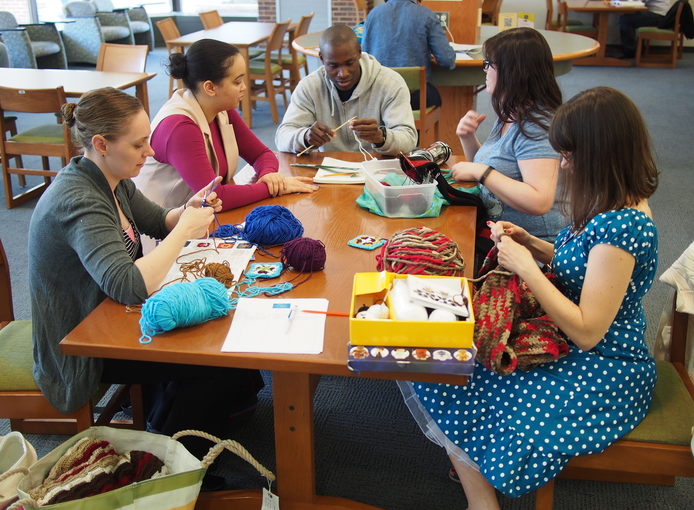
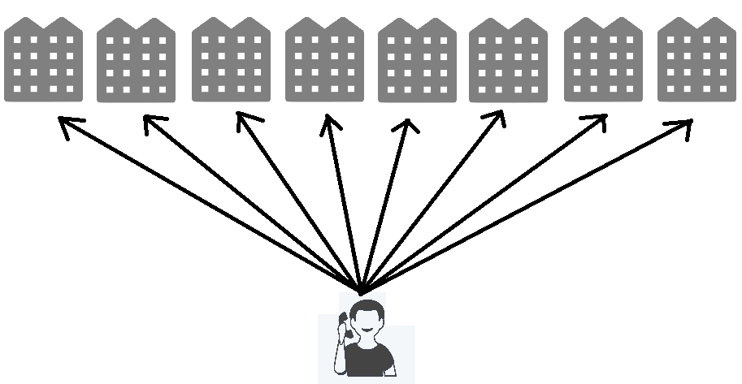
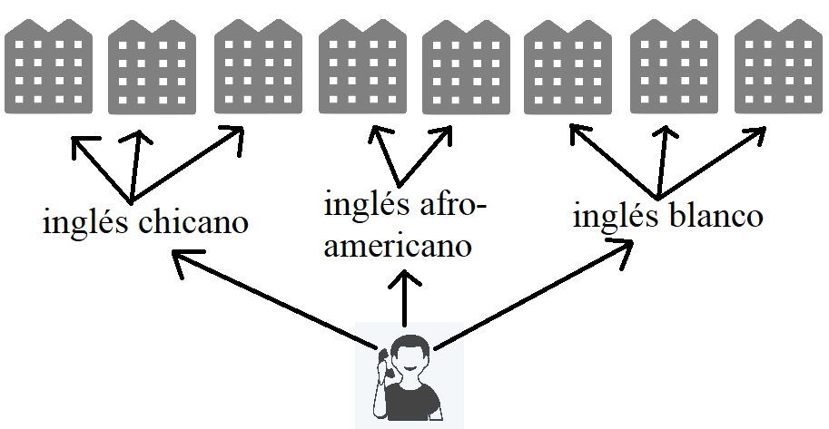
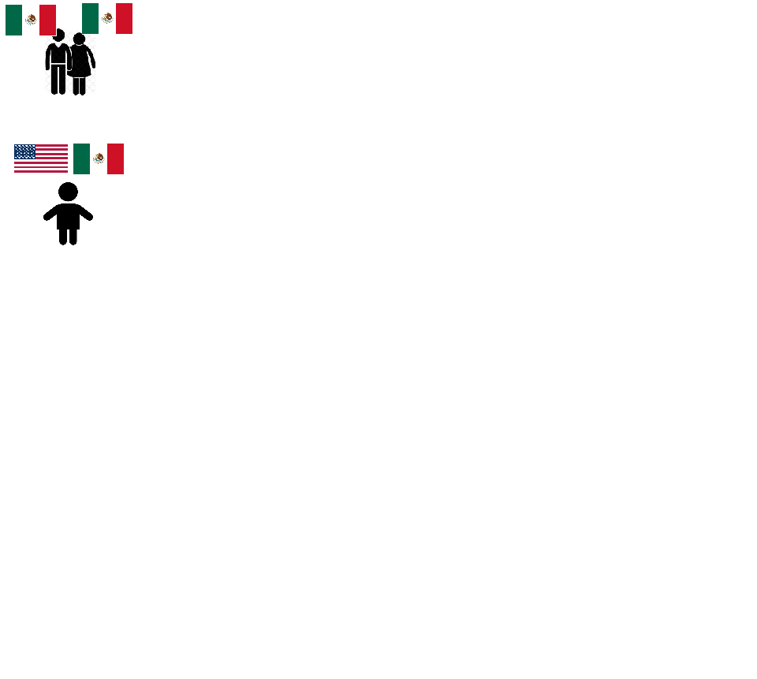
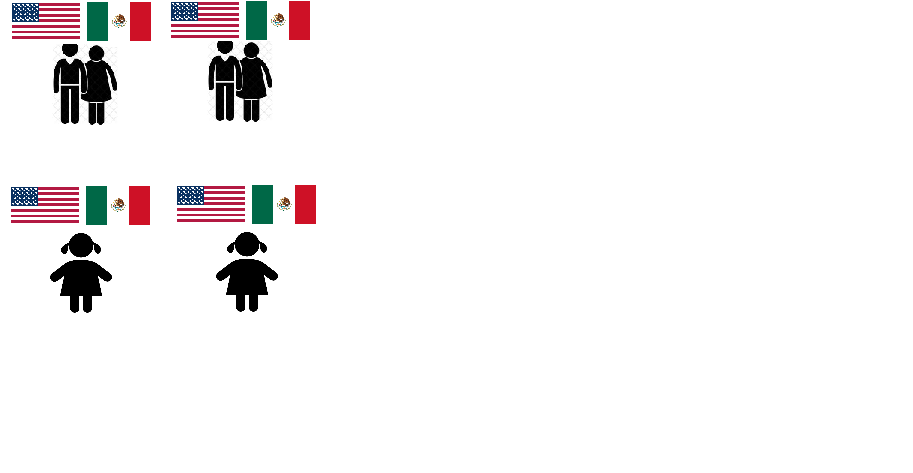
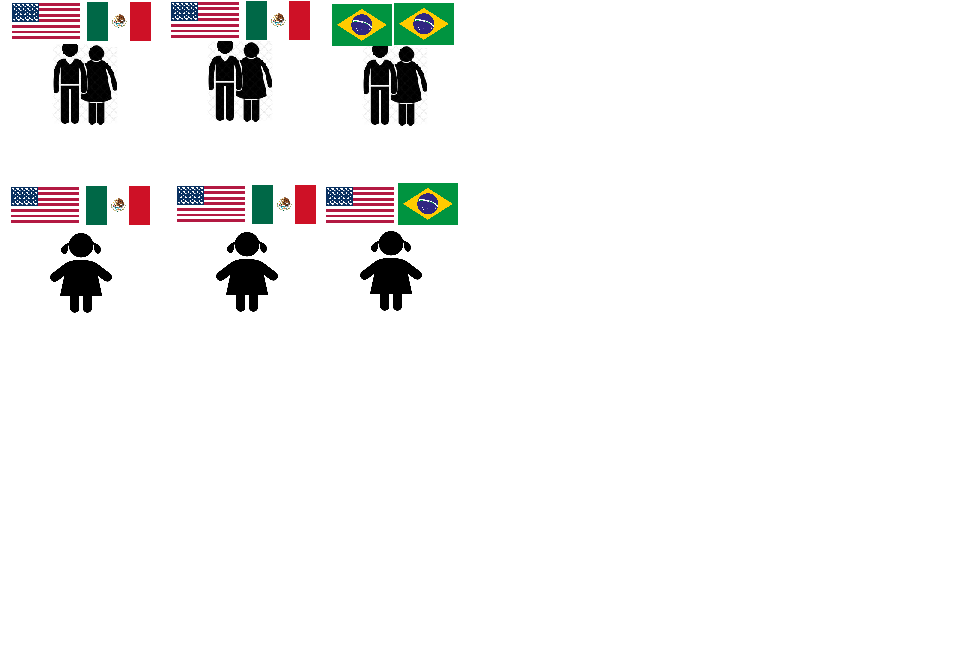
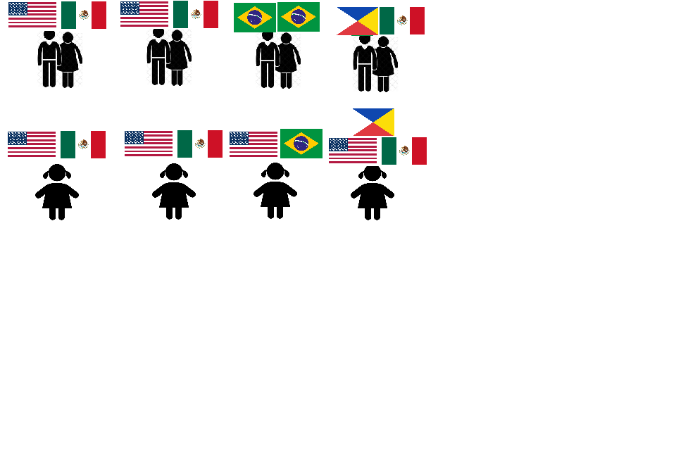
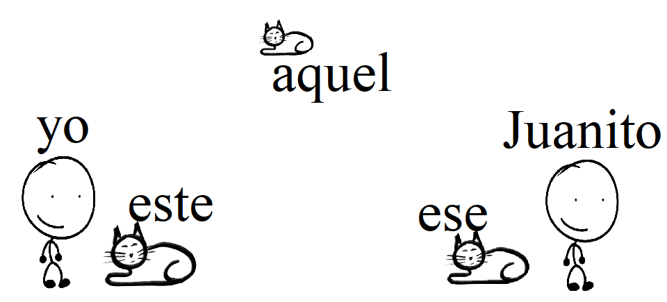

```{r}
library(here)
library(knitr)
library(tidyverse)
```

# Fundamentos {.transition}

##

<center>
**[¿Quiénes somos?]{.emph}**
</center>

- Somos RU Bilingual
- Estudiantes graduados del departamento de español y portugués de la Universidad de Rutgers
- Estudiamos el bilingüismo y la adquisición de una segunda lengua

##

<center>
**[¿Qué hacemos?]{.emph}**
</center>

- Queremos que nuestra investigación sea útil para un público más amplio
- Queremos crear un espacio seguro para debatir sobre el multilingüismo en nuestras comunidades

##

<center>
**[Nuestros objetivos:]{.emph}**
</center>

- Apoyar y defender el bilingüismo en el hogar, en la escuela y en nuestra comunidad
- Permitir que la investigación académica tenga más aplicaciones prácticas

# Lo que vamos a cubrir {.transition}

::: {.fragment .fade-up}
::: {.fragment .semi-fade-out}
¿Qué heredamos?
:::
:::

::: {.fragment .fade-up}
::: {.fragment .semi-fade-out}
¿Qué son las actidudes lingüísticas?
:::
:::

::: {.fragment .fade-up}
::: {.fragment .semi-fade-out}
¿Cómo reflejamos nuestras comunidades en nuestras formas de hablar?
:::
:::


::: {.fragment .fade-up}
::: {.fragment .semi-fade-out}
Hablantes de herencia
:::
:::

# ¿Qué heredamos? {.transition}

## ¿Qué heredamos?


## ¿Qué heredamos de nuestras familias?

:::: {.columns}

::: {.column width="50%"}

{width="400" height="300"}

{width="400" height="300"}
:::

::: {.column width="50%"}

{width="400" height="300"}

{width="400" height="300"}

:::

::::

## ¿Qué heredamos de nuestras comunidades?

:::: {.columns}

::: {.column width=50%}

{width="400" height="300"}

{width="400" height="300"}

:::

::: {.column width=50%}

{width="400" height="300"}
{width="400" height="300"}

:::

::::

## ¿Qué heredamos de nuestras comunidades?

::: {.fragment .fade-up}
::: {.fragment .semi-fade-out}
- Destrezas
:::
:::

::: {.fragment .fade-up}
::: {.fragment .semi-fade-out}
- Conocimiento
:::
:::

::: {.fragment .fade-up}
::: {.fragment .semi-fade-out}
- Experiencia
:::
:::

# La lengua como herencia {.transition}

## ¿Qué aspectos de la lengua heredamos?


## ¿Qué aspectos de la lengua heredamos? 

- Las palabras
- Los sonidos
- La jerga
- El lenguaje corporal
- Las actitudes lingüísticas

# Actitudes lingüísticas

## {background-image="assets/paises_hispanohablantes.avif"}

## Actitudes lingüísticas

<center>
[Percepción]{.emph} o consideración de un hablante [hacia la lengua, o su uso]{.emph}, y que puede estar relacionada con una serie de [creencias generalizadas a nivel social]{.emph}.
</center>

::: {.fragment}

Las actitudes pueden ser [positivas]{.emph} o [negativas]{.emph}

:::

::: footer
fuente: https://hispaniclinguistics.com/glosario/actitud-linguistica/
:::

::: notes
(Read the quote.)
Pero qué quiere decir eso? Que juzgamos a una persona dependendo de como habla, por lo bueno o por lo malo. Por ejemplo, cuando una persona habla muy claro y usa palabras muy complicadas, puede que pensemos que esta persona es bien educada. O tal vez has escuchado a alguien hablar 'fresa'. Si alguien habla 'fresa', qué opinas de esa persona? (wait for people to respond. If no one responds: Crees que viene de una familia con dinero?)
:::

## Actitudes lingüísticas


::: footer
@baugh2003linguistic
:::

::: notes
Un investigador llamado John Baugh quería ver los efectos de las actitudes linguísticas en la vida real.

:::

## Actitudes lingüísticas



::: footer
@baugh2003linguistic
:::

::: notes
Buscaba un apartamento para rentar y llamó a varios dueños.

:::

## Actitudes lingüísticas



::: footer
@baugh2003linguistic
:::

::: notes
Pero habló con tres acentos diferentes. Un acento blanco, un acento afroamericano y un acento chicano. Usó las mismas palabras, pero acentos diferentes. ¿Qué creen que pasó? Sólo recibió más información de los dueños cuando usó el acento blanco. Las creencias que tenemos sobre el lenguaje tienen un afecto real sobre la vida de las personas.
:::

## Actitudes lingüísticas

¿De qué otras maneras pueden las actitudes lingüísticas afectan a las personas?

::: notes
(just read and elicit responses if no one answers. eg: pensamos en un tribunal... o en una clínica... ask about their experiences: ustedes creen que te han tratado de menos por hablar con un cierto acento?)
:::

## Actitudes lingüísticas

<center>
Las [creencias]{.emph} sobre la lengua típicamente reflejan creencias [sobre personas]{.emph}, no lenguaje.
</center>

::: notes
Les voy a dejar con esta cita muy importante. (read citation.) Es decir, de una forma u otra, tenemos creencias sobre el lenguaje. Tal vez creemos que las personas que comen la s no tienen educación, o creemos que los argentinos hablan bonito. Pero deberíamos tener cuidado con estas creencias y reflexionar cuando tenemos una reacción negativa frente a una persona por su forma de hablar.
:::

# Nuestras comunidades y formas de hablar

## ¿A qué comunidades pertenecemos?

p. ej.

- nacionalidad
- religión
- una clase de lengua
- trabajador
- sexualidad
- género
- ...?

## ¿A qué comunidades pertenecemos?

¿Hablas de un cierto modo por ser parte de una comunidad?

p. ej.

- los méxicanos pueden [pronunciar]{.emph} 'tl' como en la palabra 'tlacote', mientras que otras variedades tienen dificuldades a pronunciarla
- trabajas en una fábrica y conoces muchas [palabras especializadas]{.emph}
- los españoles parecen [maleducados]{.emph}
  - ¿por qué será?

# Hablantes de herencia {.transition}

## Hablantes de herencia



## Hablantes de herencia



## Hablantes de herencia



## Hablantes de herencia



## Tipos de bilingües

bilingüe [receptivo]{.emph}: puede entender y/o leer, pero tiene dificuldades al hablar/escribir

bilingüe [productivo]{.emph}: puede entender y hablar

## Hablantes de herencia

¿Cómo hablan los hablantes de herencia de español en estados unidos?

¿Usted tiene hijos que son bilingües?

¿Has notado errores comunes?

## "No sabo"

¡Los 'errores' tienen orígenes lógicos!

¿Qué motivación tiene un hablante de herencia decir 'no sabo' en vez de 'no sé'?

## La analogía

::: {.columns}

::: {.column width="50%"}
::: {.fragment}
beber
:::
:::

::: {.column width="50%"}
::: {.fragment}
Yo... [beb[o]{.emph}]{.fragment}
:::
:::
:::

::: {.columns}

::: {.column width="50%"}
::: {.fragment}
comer
:::
:::

::: {.column width="50%"}
::: {.fragment}
yo... [com[o]{.emph}]{.fragment}
:::
:::
:::

::: {.columns}

::: {.column width="50%"}
::: {.fragment}
aprender
:::
:::

::: {.column width="50%"}
::: {.fragment}
Yo... [aprend[o]{.emph}]{.fragment}
:::
:::
:::

::: {.columns}

::: {.column width="50%"}
::: {.fragment}
saber
:::
:::

::: {.column width="50%"}
::: {.fragment}
Yo... [sab[o]{.emph}?]{.fragment}
:::
:::
:::

## Bilingües nativos y la mente

Los bilingües nativos...

::: {.fragment}
- tienen que aprender dos idiomas a la misma vez
:::

::: {.fragment}
- tienen menos exposición a las dos lenguas comparados con monolingües
:::

::: {.fragment}
- normalmente hablan los dos idiomas en contextos específicos
:::

## Bilingües nativos y la mente

¿Cuándo te toca usar el español?

¿Cuándo crees que un bilingüe nativo en EEUU usa el español?

¿Cuándo te toca usar el inglés?

¿Cuándo crees que un bilingüe nativo en EEUU usa el inglés?

## Una mente, dos idiomas

:::: {.columns}

::: {.column width="50%"}


:::

::: {.column width="50%"}
::: {.fragment}

:::
:::

::::

## Una mente, dos idiomas

:::: {.columns}

::: {.column width="50%"}


esquina

:::

::: {.column width="50%"}


rincón
:::

::::

## Una mente, dos idiomas

:::: {.columns}

::: {.column width="50%"}


esquina

:::

::: {.column width="50%"}


rincón
:::

<br><br><br>
<center>
corner
</center>

::::

## Una mente, dos idiomas



## Una mente, dos idiomas

- Aunque cometan "errores" al hablar, los hablantes de herencia están tratando de resolver dos sistemas al mismo tiempo

- Buscan patrones en los dos idiomas y a veces los patrones se cruzan

## ¿Cómo puedo apoyar a mis hijos?

- Dejarlos hablar sin juzgar

- Corregirles mucho NO AYUDA

- Usar el español en contextos diferentes

## La herencia

- El español es una forma de herencia que tienen sus hijos

- Es importante mantener el idioma porque le da una perspectiva diferente del inglés a la realidad

## ¡Gracias! {.final visibility="uncounted"}

::: {.absolute top="20" left="0"}
<div style="text-align:center;">


<p style="margin-top:8px; font-size:14px;">
\@ru_bilingual
</p>
</div>
:::

{.absolute top="0" right="0" width="200" height="200"}

::: {.absolute top="300" left="0"}
<div style="text-align:center;">


<p style="margin-top:8px; font-size:14px;">
Slides
</p>
</div>
:::

::: {.absolute top="300" right="-50"}
<div style="text-align:center;">


<p style="margin-top:8px; font-size:14px;">
link to bilingual children's books
</p>
</div>

:::

</br>


<br>

<table style="border-collapse: collapse; border: none;">

  <tr>
    <td style="text-align: right; padding-right: 10px;">
      <a href="https://www.instagram.com/ru_bilingual/"></a>
    </td>
    <td>\@ru_bilingual</td>
  </tr>

  <tr>
    <td style="text-align: right; padding-right: 10px;">
      <a href="mailto:rme70\@scarletmail.rutgers.edu"></a>
    </td>
    <td>rme70\@scarletmail.rutgers.edu</td>
  </tr>

  <tr>
    <td style="text-align: right; padding-right: 10px;">
      <a href="https://robertespo.github.io/"></a>
    </td>
    <td>robertespo.github.io</td>
  </tr>

  <tr>
    <td style="text-align: right; padding-right: 10px;">
      <a href="https://github.com/RobertEspo"></a>
    </td>
    <td>\@RobertEspo</td>
  </tr>
  
  <tr>
    <td style="text-align: right; padding-right: 10px;">
      <a href="https://www.jvcasillas.com/quarto-rutgers-theme/"></a>
    </td>
    <td>jvcasillas.com/quarto-rutgers-theme</td>
  </tr>
  

</table>

## References {visibility="uncounted"}

::: {#refs .smaller}
:::